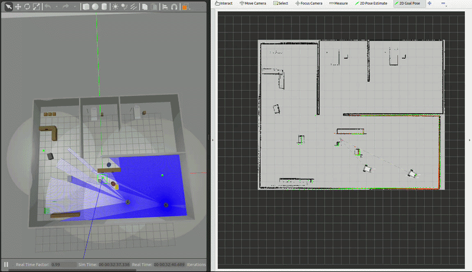

# GForce Multi-Rover Communication — ROS 2 (Humble) + Gazebo Classic

A multi-rover hospital delivery system with **decentralized, auction-based goal negotiation**. Built on ROS 2 Humble and Gazebo Classic 11.

Each rover runs its own autonomous agent. When a goal is broadcast to the fleet, every rover independently computes its distance, publishes a claim, and — from the same set of claims — independently reaches the *same* conclusion about who won. There is no central arbiter. If the winner gets blocked it releases the goal to the fleet, and a peer takes over.

> **Fork of** [bismanroopsingh/Ros-project](https://github.com/bismanroopsingh/Ros-project) — extended from single-robot delivery to decentralized multi-rover coordination.

---

## Table of Contents

- [Features](#features)
- [Architecture](#architecture)
- [Negotiation Protocol](#negotiation-protocol)
- [Project Structure](#project-structure)
- [Prerequisites](#prerequisites)
- [Installation](#installation)
- [Quick Start](#quick-start)
- [Sending Goals](#sending-goals)
- [Configuration](#configuration)
- [Key Locations](#key-locations)
- [Operational Notes](#operational-notes)
- [Known Issues & Fixes](#known-issues--fixes)
- [Troubleshooting](#troubleshooting)
- [License](#license)

---

## Features

- **Two identical differential-drive rovers** in one hospital world, fully namespaced (separate TF trees, costmaps, controllers, AMCL)
- **Decentralized auction** — nearest rover wins; every agent reaches the same verdict independently, with no central "brain" and no single point of failure
- **Stuck detection** — each agent monitors its own progress and declares itself blocked
- **Handoff** — a blocked rover releases the goal; a peer claims and continues it
- **Retry guard** — a rover backs off goals it has already failed, so an unreachable goal cannot ping-pong around the fleet forever
- **Re-claim** — if a blocked rover's path clears and it is significantly closer, it can request the goal back
- Custom differential-drive robot with 360° 2D LiDAR (0.35–12 m)
- L-shaped hospital world: patient rooms, nurses station, reception, charging bay
- Nav2 with NavFn global planner, DWB local controller, AMCL localization

---

## Architecture

Decentralized. `goal_dispatcher` only *broadcasts* and *observes* — it does not assign.

```
        RViz "2D Goal Pose"  ──►  /goal_pose
                                      │
                                      ▼
                          ┌───────────────────────┐
                          │   goal_dispatcher     │  broadcast + monitor only
                          └───────────┬───────────┘
                                      │
                          /fleet/goal_broadcast
                    ┌─────────────────┴─────────────────┐
                    ▼                                   ▼
        ┌───────────────────────┐           ┌───────────────────────┐
        │  rover1_agent         │◄─────────►│  rover2_agent         │
        │  (rover_agent.py)     │  /fleet/  │  (rover_agent.py)     │
        │                       │   task_   │                       │
        │  • compute distance   │  negotia  │  • compute distance   │
        │  • publish CLAIM      │   tion    │  • publish CLAIM      │
        │  • resolve winner     │           │  • resolve winner     │
        │  • detect stuck       │           │  • detect stuck       │
        │  • RELEASE / re-claim │           │  • RELEASE / re-claim │
        └───────────┬───────────┘           └───────────┬───────────┘
                    │ NavigateToPose                    │ NavigateToPose
                    ▼                                   ▼
            rover1 Nav2 stack                   rover2 Nav2 stack
```

Both agents also publish `/fleet/rover_status` at 1 Hz so each knows its peers' state, position and distance-to-goal.

### Fleet topics

| Topic | Type | Purpose |
|---|---|---|
| `/fleet/goal_broadcast` | `GoalBroadcast` | New goal announced to all rovers |
| `/fleet/task_negotiation` | `TaskNegotiation` | CLAIM / RELEASE / HANDOFF messages |
| `/fleet/rover_status` | `RoverStatus` | Per-rover state at 1 Hz |

---

## Negotiation Protocol

```
Goal broadcast
      │
      ▼
Every rover computes its own distance and publishes a CLAIM
      │
      ▼
After auction_timeout (2 s) each rover independently picks the
nearest claimant — all agents reach the SAME winner
      │
      ├── winner  → NAVIGATING
      └── others  → standing by
      │
      ▼
Winner self-monitors every 3 s
      │
      ├── moving  → continue
      │
      └── moved < 0.05 m for 3 consecutive checks → BLOCKED
                │
                ▼
          publish RELEASE to fleet
                │
                ▼
          peer claims it (reason: "peer_blocked") and navigates
                │
                ▼
          the releasing rover records the failure and will not
          re-claim that goal until goal_retry_cooldown elapses,
          and never after max_goal_attempts
```

**Why the retry guard matters:** without it, two blocked rovers hand an unreachable goal back and forth indefinitely, each immediately re-claiming a goal it just failed. Nobody gives up and the dispatcher never learns the goal is unreachable. The guard covers *both* the release/claim path and the handoff path — the latter otherwise lets a rover re-enter a failed goal and bypass the check entirely.

---

## Project Structure

```
hospital_robot_description/
├── config/
│   ├── nav2_params_rover1.yaml       # Nav2 config, rover1 namespace
│   ├── nav2_params_rover2.yaml       # Nav2 config, rover2 namespace
│   ├── multi_rover.rviz              # RViz layout (per-rover pose tools)
│   └── slam_toolbox_params.yaml      # SLAM mapping configuration
├── launch/
│   ├── multi_rover_full.launch.py    # ★ Everything: Gazebo, 2 rovers, Nav2, agents, RViz
│   ├── multi_rover_nav2.launch.py    # Nav2 stacks only
│   ├── slam.launch.py                # SLAM mapping
│   └── nav2.launch.py                # Original single-robot Nav2
├── maps/
│   ├── my_ma_p.pgm / .yaml           # ★ Active map (origin calibrated to world)
│   └── hospital_map*.pgm / .yaml     # Earlier maps (unused)
├── meshes/                           # Robot 3D models (.stl)
├── msg/
│   ├── GoalBroadcast.msg             # Goal announced to fleet
│   ├── TaskNegotiation.msg           # CLAIM / RELEASE / HANDOFF
│   └── RoverStatus.msg               # Per-rover state broadcast
├── scripts/
│   ├── rover_agent.py                # ★ Decentralized per-rover agent
│   ├── goal_dispatcher.py            # Broadcasts goals, monitors fleet
│   └── multi_robot_tf_bridge.py      # Namespaced TF relay
├── urdf/
│   └── robot.urdf.xacro              # Robot description (parameterized)
├── worlds/
│   └── hospital.world                # Hospital SDF world (Gazebo Classic)
├── CMakeLists.txt
└── package.xml
```

---

## Prerequisites

| Dependency | Version |
|---|---|
| ROS 2 | Humble |
| Gazebo | Classic 11 |
| Ubuntu | 22.04 |

### Required ROS 2 packages

```bash
sudo apt update && sudo apt install -y \
  ros-humble-slam-toolbox \
  ros-humble-navigation2 \
  ros-humble-nav2-bringup \
  ros-humble-gazebo-ros-pkgs \
  ros-humble-gazebo-ros \
  ros-humble-joint-state-publisher \
  ros-humble-robot-state-publisher \
  ros-humble-xacro \
  ros-humble-teleop-twist-keyboard
```

---

## Installation

```bash
# Create workspace
mkdir -p ~/ros2_ws/src && cd ~/ros2_ws/src

# Clone the repository
git clone https://github.com/AshwinderPalSingh/GForce-multi-rover-communication.git hospital_robot_description

# Install dependencies
cd ~/ros2_ws && rosdep install --from-paths src --ignore-src -r -y

# Build
colcon build --packages-select hospital_robot_description

# Source
source install/setup.bash
```

---

## Quick Start

Everything comes up from one launch file — Gazebo, both rovers, both Nav2 stacks, both agents, the dispatcher and RViz:

```bash
source /opt/ros/humble/setup.bash
source ~/ros2_ws/install/setup.bash
ros2 launch hospital_robot_description multi_rover_full.launch.py
```

Verify it is healthy:

```bash
ros2 topic hz /rover1/scan      # ~10 Hz
ros2 topic hz /rover2/scan      # ~10 Hz
ros2 lifecycle get /rover1/amcl # active
```

---

## Sending Goals

**From RViz** — click **2D Goal Pose**. It publishes to `/goal_pose`, which `goal_dispatcher` re-broadcasts to the fleet, so the goal still goes through the auction rather than bypassing it.

**From the terminal:**

```bash
ros2 topic pub --once /fleet/goal_broadcast \
  hospital_robot_description/msg/GoalBroadcast \
  "{goal_id: 'g1', goal_x: -4.0, goal_y: -3.0, goal_yaw: 0.0}"
```

**Watch the negotiation live:**

```bash
ros2 topic echo /fleet/task_negotiation   # CLAIM / RELEASE traffic
ros2 topic echo /fleet/rover_status       # per-rover state
```

Expected output:

```
🏁 Published CLAIM for [g1] — my distance: 4.03m
🏆 Auction [g1] resolved: winner=rover1 (dist=4.03m)
🚀 Navigating to (-4.00, -3.00)
✅ Goal [g1] REACHED!
```

### Correcting a drifted rover

AMCL corrects `map → odom` in discrete steps, so a rover can appear to jump in RViz while moving smoothly in Gazebo. To re-seed it, use **2D Pose Estimate** and drag the arrow at the rover's true pose.

There are **two** pose-estimate buttons — the **first is rover1, the second is rover2** (RViz labels both with the plugin name, so toolbar order is the only cue).

---

## Configuration

### Agent parameters

Set in `launch/multi_rover_full.launch.py`:

| Parameter | Default | Description |
|---|---|---|
| `auction_timeout` | `2.0` s | Wait for peer claims before deciding the winner |
| `progress_check_interval` | `3.0` s | How often a rover checks its own progress |
| `stuck_distance_threshold` | `0.05` m | Movement below this counts as no progress |
| `stuck_consecutive_checks` | `3` | Consecutive low-movement checks → BLOCKED |
| `reswitch_distance_ratio` | `0.5` | Re-claim only if closer than 50 % of the active rover |
| `goal_tolerance` | `0.5` m | Agent-side "close enough to stop nagging" |
| `goal_retry_cooldown` | `30.0` s | Backoff before retrying a failed goal |
| `max_goal_attempts` | `2` | Attempts per rover before giving up entirely |

### Rover spawn positions

| Rover | x | y |
|---|---|---|
| rover1 | 0.0 | −2.9 |
| rover2 | 3.0 | −2.9 |

These must match `amcl.initial_pose` in each rover's Nav2 params, which seeds localization at startup.

---

## Key Locations

| Location | x | y | Notes |
|---|---|---|---|
| Rover1 Spawn | 0.0 | −2.9 | Main corridor |
| Rover2 Spawn | 3.0 | −2.9 | Main corridor |
| Supply Table | −8.5 | 8.0 | Delivery Stop 1 |
| Reception Desk | −8.5 | 7.5 | Delivery Stop 2 |
| Nurses Station | 1.0 | −0.5 | In front of desk |
| Charging Dock | −8.5 | −4.5 | Storage bay |
| Room 1 Doorway | 0.0 | 3.0 | Outside patient room |
| Room 2 Doorway | 6.0 | 3.0 | Outside patient room |

---

## Operational Notes

**Give goals ≥ 0.9 m of wall clearance.** The chassis is 0.9 × 0.87 m, giving a 0.485 m inscribed radius. A goal closer than that to a wall sits in a cell the planner treats as impassable, so planning fails and the rover eventually declares itself blocked. Goals such as `(-4,-3)`, `(-6,-3)`, `(+6,-3)` and `(+8,-3)` have 1.6–2.0 m clearance and complete reliably.

**There is a 0.70 m pinch at x ≈ 0, y ≈ 0** (between the nurses' desk and the filing cabinet). The robot is 0.87 m wide and *cannot* pass it. The map is still fully connected via the southern corridor, but a straight-line route through the middle will not plan.

**A failed goal leaves rovers where they gave up.** After chasing an unreachable goal, rovers park wherever they stopped — sometimes a cluttered corner from which later goals also fail. Re-seed with 2D Pose Estimate, or send a goal in open space to walk them out.

**Idle creep.** The drive-wheel joints have no damping, so a stationary rover drifts ≈ 1.5 mm/s. Harmless for navigation.

---

## Known Issues & Fixes

### World would not load under Gazebo Classic
**Cause:** `hospital.world` was still Ignition format — SDF 1.8, `physics type="ignored"`, and `ignition-gazebo-*-system` plugins. Classic 11 parses only up to SDF 1.7 and has no "ignored" physics type, so `gzserver` aborted at world load and the whole stack ran against a simulation that never started.
**Fix:** Converted to SDF 1.6 with an ODE physics block; dropped the Ignition system plugins (physics, sensors, scene broadcasting and user commands are built into `gzserver`).

### Rovers spawned upside down / appeared to teleport
**Cause:** The two casters hung below the drive wheels at *mismatched* heights — caster 1 by 90 mm, caster 3 by 15 mm. Each rover balanced on a single corner with a high payload centre of mass and rolled onto its back, deterministically, on every launch. This was a model bug, not a simulator bug, which is why switching simulators never fixed it.
**Fix:** Raised both caster collision spheres so they contact the floor level with the drive wheels.

### AMCL diverged by metres
**Cause:** The LiDAR sat at z = 0.495, inside the payload box (z 0.30–0.54). 80 of 360 rays returned the robot's own cargo box — a phantom obstacle welded to the rear arc that moved with the robot, poisoning the costmap and feeding AMCL scan data that could never match the map.
**Fix:** Raised the sensor to z = 0.600, clearing the box. Costs no obstacle visibility — everything below 0.60 m in this world was already beneath the old scan plane.

### Costmap inflation smaller than the robot
**Cause:** `inflation_radius: 0.05`, well below the 0.485 m inscribed radius. Nav2 logged an error at every startup and the planner would happily route the robot into walls.
**Fix:** `inflation_radius: 0.55` in both costmaps.

### Rovers drove off course instead of finishing a goal
**Cause:** Nav2's progress checker demanded 0.5 m of travel per 10 s, which a 0.9 m robot cannot satisfy during normal final fine-positioning. It declared "Failed to make progress" and fired recovery behaviours that drove rovers metres away from goals they had almost reached.
**Fix:** `required_movement_radius: 0.25`, `movement_time_allowance: 20.0`, `xy_goal_tolerance: 0.35`, `yaw_goal_tolerance: 0.50`.

### Unreachable goals ping-ponged forever
**Cause:** No guard against re-claiming a goal the rover had just failed.
**Fix:** `goal_retry_cooldown` and `max_goal_attempts`, applied to both the claim and handoff paths.

### RViz "2D Pose Estimate" did nothing
**Cause:** The tool published to the un-namespaced `/initialpose`, which had zero subscribers — AMCL listens on `/rover1/initialpose` and `/rover2/initialpose`. There was no way to correct a drifted rover from RViz.
**Fix:** Two pose-estimate tools, one per rover namespace.

---

## Troubleshooting

### Check both rovers are alive
```bash
ros2 topic hz /rover1/scan   # expect ~10 Hz
ros2 topic hz /rover2/scan   # expect ~10 Hz
```

### Check TF trees
```bash
ros2 run tf2_ros tf2_echo map rover1/base_link
ros2 run tf2_ros tf2_echo map rover2/base_link
# Expected: map → roverX/odom → roverX/base_link → roverX/lidar_link
```

### Check Nav2 came up
```bash
for n in map_server amcl planner_server controller_server bt_navigator behavior_server; do
  ros2 lifecycle get /rover1/$n
done
# all should report: active
```

### Inspect the agents
```bash
ros2 topic echo /fleet/rover_status
ros2 param get /rover1_agent max_goal_attempts
```

### Manually clear costmaps
```bash
ros2 service call /rover1/global_costmap/clear_entirely_global_costmap nav2_msgs/srv/ClearEntireCostmap {}
ros2 service call /rover2/global_costmap/clear_entirely_global_costmap nav2_msgs/srv/ClearEntireCostmap {}
```

### RViz fails to start inside a VS Code snap terminal
The VS Code snap sets `LOCPATH` to its own bundled locale data, which makes glibc load an incompatible `libpthread` and RViz dies with a `GLIBC_PRIVATE` symbol error. Launch from a normal terminal, or clear the snap variables:

```bash
env -u LOCPATH -u GTK_PATH -u GTK_EXE_PREFIX -u GDK_PIXBUF_MODULEDIR \
    -u GDK_PIXBUF_MODULE_FILE -u SNAP -u GSETTINGS_SCHEMA_DIR \
    ros2 launch hospital_robot_description multi_rover_full.launch.py
```

---

## License

MIT License — see [LICENSE](LICENSE) for details.

---

## Acknowledgements

- [bismanroopsingh/Ros-project](https://github.com/bismanroopsingh/Ros-project) — original single-robot codebase
- [Nav2 Documentation](https://navigation.ros.org/)
- [slam_toolbox](https://github.com/SteveMacenski/slam_toolbox)
- [Articulated Robotics](https://www.youtube.com/@ArticulatedRobotics)
